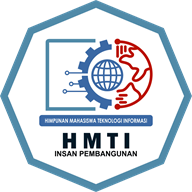

<div align="center">



# Bootcamp Himpunan Teknologi Informasi 2026

Situs pendaftaran dan informasi resmi Bootcamp HMTI — program pelatihan web development
intensif untuk mahasiswa.

<p>
  
  
  
  
  
</p>

</div>

---

## Tentang program

Bootcamp Himpunan Teknologi Informasi 2026 hadir untuk menjembatani teori di kelas dengan
praktik di dunia kerja. Peserta dibekali keterampilan web development, belajar langsung dari
mentor, dan membangun portofolio nyata selama program berlangsung.

- Kurikulum praktis berbasis proyek
- Didampingi kakak tingkat, alumni, dan dosen
- Sertifikat resmi dari HMTI
- Komunitas peserta dan kesempatan networking

## Halaman

| Rute | Fungsi |
|---|---|
| `/` | Beranda dan informasi umum program |
| `/daftar` | Formulir pendaftaran peserta |
| `/cek-status` | Memeriksa status kelolosan pendaftaran |
| `/pengumuman` | Informasi dan pengumuman resmi |
| `/galeri` | Dokumentasi kegiatan bootcamp |
| `/sertifikat` | Verifikasi dan unduh sertifikat |

## Divisi yang dibuka

| Divisi | Cakupan materi |
|---|---|
| Frontend | React, Vue, Next.js, Tailwind CSS, Git & GitHub |
| Backend | Node.js (Express), Laravel, Golang, Python |
| UI/UX Design | Figma, wireframe, prototyping, design system |
| Data & AI | Data science, machine learning, prompt engineering, SQL |

## Teknologi

Proyek ini dibangun dengan React 19 dan TypeScript, menggunakan Vite sebagai bundler dan
Tailwind CSS v4 untuk styling. Animasi halaman memakai GSAP (ScrollTrigger) dan motion,
sedangkan navigasi ditangani react-router-dom v7.

## Menjalankan secara lokal

1. Salin berkas konfigurasi environment:

   ```bash
   cp .env.example .env
   ```

2. Isi nilai pada `.env` sesuai kebutuhan:

   ```env
   VITE_VERIFY_URL=https://hmtiunipi.or.id/verify
   VITE_API_BASE_URL=
   ```

3. Pasang dependensi lalu jalankan server development:

   ```bash
   npm install
   npm run dev
   ```

Perintah lain:

```bash
npm run build     # type-check lalu build produksi ke folder dist/
npm run preview   # pratinjau hasil build produksi
```

## Struktur proyek

```
src/
├── components/        # Komponen UI dan section halaman
│   └── ui/            # Komponen UI reusable
├── pages/             # Halaman (Home, Register, Certificate, ...)
├── data/              # Konten situs dalam satu berkas (content.ts)
└── utils/             # Utilitas bersama
```

---

## Loading screen

Layar loading muncul saat pengguna membuka beranda (`/`) dan berjalan dalam dua tahap yang
tampil berurutan:

1. **Pill glassmorphism** — pill dengan efek shimmer berputar dan teks "Menyiapkan halaman utama...".
2. **Typewriter** — teks "Welcome to the bootcamp" diketik huruf demi huruf dengan kursor berkedip.

Kedua tahap berbagi efek sinematik yang sama (background beranimasi, zoom Ken Burns, letterbox,
vignette, dan film grain). Setiap tahap dapat dilewati dengan klik — perilaku ini dapat dimatikan.

### Berkas terkait

| Berkas | Peran |
|---|---|
| [`src/App.tsx`](./src/App.tsx) | Seluruh konfigurasi loading dan urutan tahapnya. |
| [`src/components/PillLoadingScreen.tsx`](./src/components/PillLoadingScreen.tsx) | Tahap 1 (pill glassmorphism). |
| [`src/components/HomeLoadingScreen.tsx`](./src/components/HomeLoadingScreen.tsx) | Tahap 2 (typewriter dan spinner). |
| [`src/components/CinematicLayers.tsx`](./src/components/CinematicLayers.tsx) | Lapisan efek sinematik bersama. |
| [`src/components/ui/glassmorphism-cta.tsx`](./src/components/ui/glassmorphism-cta.tsx) | Komponen pill glassmorphism. |
| [`src/index.css`](./src/index.css) | Keyframes animasi dan kelas visual. |

### Konfigurasi

Seluruh pengaturan terpusat di `src/App.tsx` melalui tiga objek berikut.

#### `pillLoadingConfig` — tahap 1

| Kunci | Tipe | Default | Fungsi |
|---|---|---|---|
| `label` | `string` | `'Menyiapkan halaman utama...'` | Teks utama di dalam pill. |
| `subtitle` | `string` | `'HMTI Bootcamp 2026'` | Teks kecil di bawah pill. |
| `avatarSrc` | `string` | `'/logo-192.png'` | Logo di dalam pill. |
| `avatarAlt` | `string` | `'Logo HMTI'` | Alt text logo. |
| `shimmerColor` | `string` | `'rgba(123,179,207,0.85)'` | Warna shimmer. |
| `spread` | `string` | `'90deg'` | Lebar kilau shimmer. |
| `speed` | `string` | `'4s'` | Kecepatan rotasi shimmer. |
| `glowClass` | `string` | `'shadow-[0_8px_40px_rgba(37,150,190,0.25)]'` | Glow/shadow pill. |
| `durationMs` | `number` | `900` | Durasi tahap ini (ms). |
| `skipOnClick` | `boolean` | `true` | Izinkan klik untuk melewati. |

#### `typewriterLoadingConfig` — tahap 2

| Kunci | Tipe | Default | Fungsi |
|---|---|---|---|
| `eyebrow` | `string` | `'HMTI BOOTCAMP 2026'` | Label kecil di atas judul. |
| `title` | `string` | `'Welcome to the bootcamp'` | Teks yang diketik. |
| `typingSpeed` | `number` | `65` | Kecepatan ketik (ms/karakter). |
| `holdTime` | `number` | `600` | Jeda sebelum ditutup otomatis (ms). |
| `showHint` | `boolean` | `true` | Tampilkan petunjuk klik. |
| `spinnerText` | `string` | `'Sedang memuat...'` | Teks indikator loading. |
| `skipOnClick` | `boolean` | `true` | Izinkan klik untuk melewati. |

#### `cinematicConfig` — efek sinematik

| Kunci | Tipe | Default | Fungsi |
|---|---|---|---|
| `bgFrom` / `bgVia` / `bgTo` | `string` | `'#031927'` / `'#082238'` / `'#0a2940'` | Warna gradasi background. |
| `kenBurnsScale` | `number` | `1.34` | Skala maksimal zoom background. |
| `kenBurnsDuration` | `string` | `'22s'` | Durasi zoom background. |
| `gradientPanDuration` | `string` | `'16s'` | Durasi pergeseran gradasi. |
| `cinematicZoomScale` | `number` | `0.82` | Skala awal zoom konten (lebih kecil = lebih dramatis). |
| `cinematicZoomDuration` | `string` | `'1.2s'` | Durasi zoom masuk konten. |
| `letterboxHeight` | `string` | `'clamp(4rem, 6vw, 6rem)'` | Tinggi bar letterbox. |
| `letterboxColor` | `string` | `'rgba(0, 0, 0, 0.9)'` | Warna bar letterbox. |
| `grainOpacity` | `number` | `0.04` | Opacity film grain (0–1). |
| `vignetteStrength` | `number` | `0.5` | Kekuatan vignette (0–1). |

### Contoh penyesuaian

Tema gelap dengan aksen emas:

```ts
export const cinematicConfig: CinematicConfig = {
  bgFrom: '#0a0a0f',
  bgVia: '#12121c',
  bgTo: '#1a1626',
  kenBurnsScale: 1.5,
  cinematicZoomScale: 0.75,
  letterboxColor: 'rgba(0, 0, 0, 1)',
  grainOpacity: 0.06,
  vignetteStrength: 0.7,
}
```

### Catatan teknis

- Semua animasi memakai properti `transform` dan `opacity` (GPU-composited) sehingga tetap
  ringan di perangkat dengan spesifikasi rendah.
- Saat sistem mengaktifkan *reduce motion* (`prefers-reduced-motion: reduce`), layar loading
  dilewati dan animasi sinematik dimatikan.
- Kursor dan petunjuk klik hanya muncul ketika `skipOnClick` bernilai `true`.

---

<div align="center">

**Himpunan Mahasiswa Teknologi Informasi** · Bootcamp 2026

</div>
